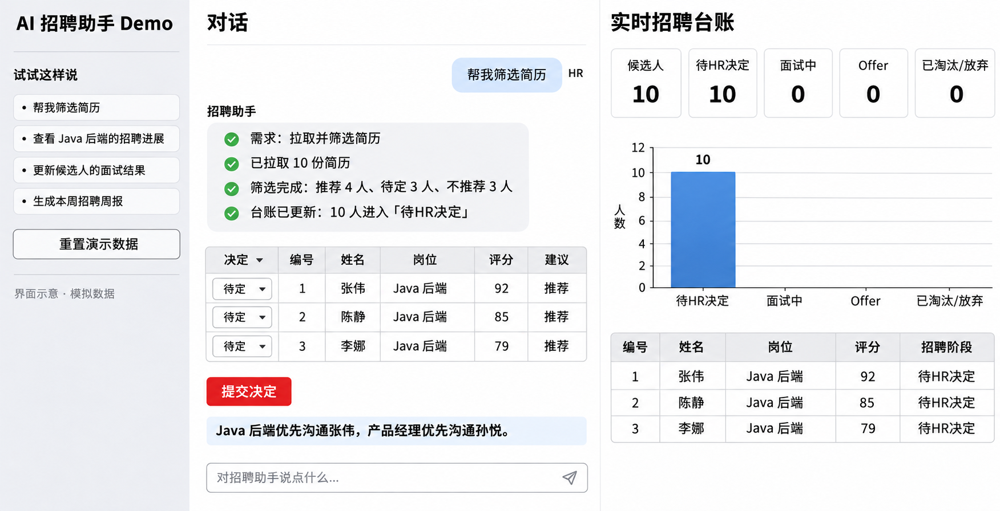
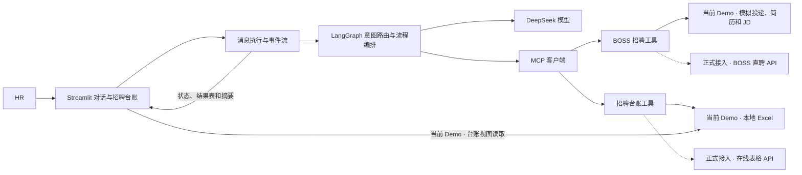

# AI 招聘助手 Demo

HR 在对话框输入「帮我筛选简历」，助手会拉取投递、按岗位要求做初筛，并把评分、建议和理由写入招聘台账。HR 可以在结果表中决定谁进入一面、谁淘汰，并在右侧查看更新后的招聘进度。

正式接入方案使用 **BOSS 直聘 API** 获取投递、简历和岗位信息，使用 **在线表格 API** 维护候选人记录与跟进流水。当前 Demo 已实现这两类能力的 MCP 工具接口，BOSS 端由模拟导出文件提供数据，台账端读写本地 Excel。两个线上 API 均待接入。

## 界面示意 · 帮我筛选简历



*图 1. 根据项目界面结构生成的示意图。假设台账初始为空，10 份模拟投递均完成初筛和回写。分数、推荐人数和总结文案为演示值，表格仅展示部分候选人及字段。*

提交「帮我筛选简历」后，界面依次显示需求识别、投递导入、简历初筛和台账更新。完成后，左侧按岗位分组、组内按评分从高到低显示候选人。右侧在写入成功后刷新候选人总数、各阶段人数、明细和最近的跟进流水。图中 10 人处于「待HR决定」，「已淘汰/放弃」为 0。

初筛表会给每位候选人分配一个可在对话中引用的编号，并显示岗位、学历和工作年限、期望薪资、AI 评分、建议与理由。以下三行对应图中的示例，补充了完整结果表中的信息。

| 编号 | 姓名 | 岗位 | 学历 / 年限 | 期望薪资 | 评分 | 建议 | 理由 |
| --- | --- | --- | --- | --- | ---: | --- | --- |
| 1 | 张伟 | Java 后端开发工程师 | 本科 / 5 年 | 26–30K | 92 | 推荐 | 有 Spring Cloud 微服务、高并发和数据库调优经验，期望薪资在岗位区间内。 |
| 2 | 陈静 | Java 后端开发工程师 | 本科 / 7 年 | 28–32K | 85 | 推荐 | 分布式系统和消息中间件经验匹配，期望薪资上限高于岗位预算。 |
| 3 | 李娜 | Java 后端开发工程师 | 硕士 / 3 年 | 22–26K | 79 | 推荐 | 支付清结算经验和主要技能匹配，可进一步确认 Spring Cloud 项目经验。 |

结果表下方会生成一段摘要，例如：

> 共完成 10 份简历初筛，其中 Java 后端推荐 3 人，产品经理推荐 1 人。Java 后端可优先沟通张伟，产品经理可优先沟通有招聘系统经验的孙悦。陈静的期望薪资上限超过岗位预算，建议先确认。请在「决定」列选择后点击「提交决定」，也可以直接回复「1、3 进一面」。

「决定」默认选中「待定」。HR 可改选「进一面」或「淘汰」并提交，对应候选人的阶段更新为「待一面」或「已淘汰」。AI 建议中的「不推荐」仍进入「待HR决定」，由 HR 作出最终选择。

## 架构设计



| 组件 | 职责 |
| --- | --- |
| [Streamlit 界面](app.py) | 输入对话和 HR 决定，显示状态、筛选结果表、台账统计与跟进流水。 |
| [执行与事件流](hrdemo/runner.py) | 在后台执行异步工作流，把状态、表格、摘要和台账刷新事件交给界面。 |
| [LangGraph 工作流](hrdemo/graph.py) | 将意图路由到初筛、候选人状态更新、进度查询或普通对话。 |
| [DeepSeek 模型客户端](hrdemo/llm.py) | 通过 OpenAI 兼容接口获取结构化意图和评分，并流式生成摘要。 |
| [MCP 客户端](hrdemo/mcp_client.py) | 以子进程启动招聘和台账两个 MCP 服务，通过标准输入输出调用工具。 |

### BOSS 直聘 API · 招聘数据入口

正式接入时，招聘工具使用企业获授权的 BOSS 直聘 API 获取投递列表、候选人简历和岗位 JD（职位描述）。工具将外部字段转换为流程使用的内部字段，用投递编号关联候选人记录与简历。实际可读取的数据和字段以企业获授权的接口能力为准。

工作流当前调用 `list_new_applications`、`get_resume` 和 `get_job`。Demo 中，这三个工具分别读取最新的模拟导出 Excel、按投递编号保存的文本简历和 `jobs.json`。这三个名称是项目的 MCP 工具名。[模拟 BOSS MCP 服务](mcp_servers/boss_mock_server.py)

### 在线表格 API · 招聘台账

正式接入时，台账工具通过所选在线表格平台的 API 查询和写入候选人记录，并追加跟进流水。候选人记录以候选人 ID 定位，保存岗位、评分、建议、理由、当前阶段、面试时间和面试官等信息。流水记录操作人、操作时间及阶段变化。界面的台账视图也需通过在线台账读接口刷新。

工作流当前调用 `list_candidates`、`upsert_candidates`、`update_candidates` 和 `get_logs`。Demo 中，这些工具通过 `openpyxl` 操作 `data/招聘台账.xlsx`，右侧台账视图直接读取同一文件。在线表格平台待选定。[台账 MCP 服务](mcp_servers/ledger_server.py) · [本地台账实现](hrdemo/ledger.py)

## 简历筛选流程

1. **识别意图并导入投递。** LangGraph 将「帮我筛选简历」路由到初筛流程。BOSS 工具返回投递，台账按投递编号去重，新增记录进入「待筛选」。
2. **读取岗位和简历。** 系统查询所有「待筛选」记录，按岗位读取 JD，再按投递编号读取简历正文，因此之前未完成初筛的记录也可以再次尝试。
3. **生成评分与理由。** DeepSeek 按岗位要求与简历内容评分，包括核心技能、工作年限、学历和薪资匹配。评分范围为 0–100，75 分及以上为「推荐」，60–74 分为「待定」，低于 60 分为「不推荐」。
4. **回写初筛结果。** 成功回写后，候选人的评分、建议和理由进入台账，阶段调整为「待HR决定」。评估失败且被跳过的记录留在「待筛选」。
5. **展示结果并收集决定。** 助手读取台账中所有「待HR决定」的记录，生成编号、结果表和摘要。HR 可以在表中直接提交，也可以用编号回复。阶段变更成功后，台账追加流水并刷新界面。

## 本地运行

在项目根目录安装依赖。如果还没有 `.venv`，先执行 `python3 -m venv .venv`。

```bash
.venv/bin/python -m pip install -r requirements.txt
```

在根目录的 `.env` 中配置 `DEEPSEEK_API_KEY`，再启动 Streamlit。

```bash
.venv/bin/python -m streamlit run app.py
```

默认访问 `http://localhost:8501`。若缺少模拟投递文件，可运行 `.venv/bin/python scripts/make_mock_data.py` 生成模拟数据，再输入「帮我筛选简历」。
